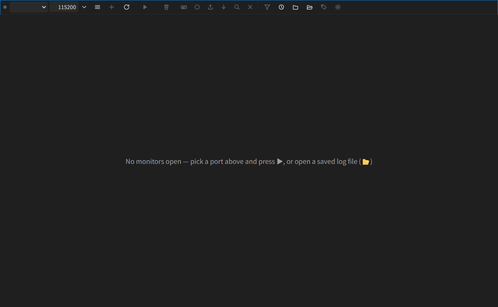
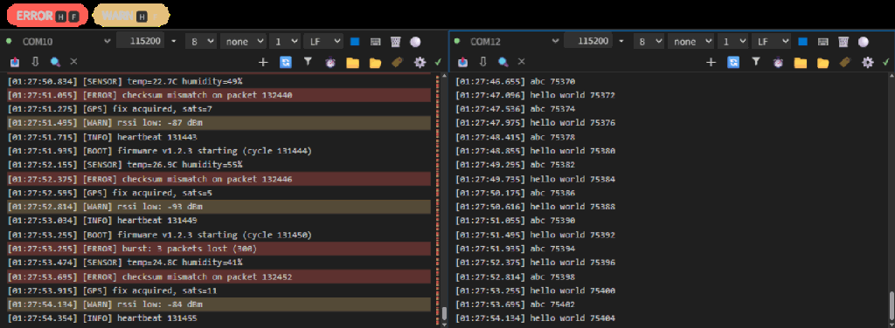

# Serial Monitor (OSS)

[](https://github.com/SimpleHK/vscode-serial-monitor-oss/actions/workflows/ci.yml)
[](LICENSE)
[](CHANGELOG.md)

**Monitor serial ports inside VS Code — several at once, side by side.** An
open-source (MIT) rebuild of the archived Microsoft Serial Monitor, with the
features no other serial monitor has: tag highlighting, a display-layer
filter, per-pane search with an editor-style find widget, and a console that
stays smooth at 2000 lines/second.



## Why this one

- **Multiple ports, one view.** Open COM10 and COM12 simultaneously — each
  pane keeps its own buffer, serial settings, log file, and scroll position
  while the other keeps streaming.
- **Nothing is ever lost.** The filter is display-layer only: include or
  exclude tag matches and every line is still in the buffer when you switch
  back.
- **Search that feels like your editor.** Ctrl+F in any pane: match case,
  whole word, regex, occurrence counter, F3 navigation — highlights don't
  break text selection.
- **Open and honest.** MIT-licensed, from-scratch, architecture decisions and
  a domain glossary checked in; no telemetry, no closed blobs.

## Features

### Split view, self-contained panes

Every pane is a full monitor: its own serial config (port, baud, data bits,
parity, stop bits, line ending), start/stop, clear, log-to-file, export,
follow/lock, find, and a send bar with arrow-key history. Click **＋**, pick a
port, and the view splits — settings clone from the newest pane so a second
device is two clicks away. Change baud **while connected** and the port
reopens live, keeping the pane, its buffer, and its log file.

### Tags: highlight and filter

Select text → tag it. Every matching line is highlighted across the full line
with that tag's color (multiple tags stack), marked on the overview strip
beside the scrollbar, and can drive the include/exclude filter. Chips toggle
highlight and filter independently; the funnel menu switches the filter mode.
Nothing is discarded — switching the filter back recovers every line still in
the buffer.

### Find per pane



Ctrl+F opens an editor-style find widget with **Aa** match-case, **ab**
whole-word, and **.*** regex toggles, a live occurrence counter, and F3 /
Shift+F3 navigation. Matches are highlighted in place and pinned on the
overview strip; clicking the strip jumps to the nearest match.

### Display-layer filter


Three states — off / include / exclude — over tag matches. Toggling is
instant and reversible for as long as lines stay in the capped ring buffer
(10,000 lines by default).

### The rest of a real monitor

- Per-line receive timestamps (on by default), send bar with line-ending
  choice and arrow-key history
- Per-session log-to-file (one timestamped `.log` per connection) and
  one-shot export
- Open a saved `.log`/`.txt` as a read-only pane — find, filter, and export
  work on recorded data
- Follow/Lock scrolling per pane; overview marks for highlights and find
  hits; draggable split
- Baud quick-pick with recently-used list; 300 baud → 2 Mbaud; live serial
  parameter reconfiguration

## Quick start

```bash
git clone https://github.com/SimpleHK/vscode-serial-monitor-oss.git
cd vscode-serial-monitor-oss
npm install && npm run package
```

Install the generated `.vsix` (`Extensions: Install from VSIX…`) or press
**F5** to run it from source. The monitor appears in the bottom panel as
**SERIAL MONITOR**.

No hardware? A com0com virtual pair works: `npm run smoke:check`, then feed
it with `npm run smoke:device -- --scenario lines`.

> [!NOTE]
> Working with real hardware is at your own risk — double-check baud rates
> and voltage levels before connecting anything you care about.

## Public API

Other extensions can drive it through the vendored
`@microsoft/vscode-serial-monitor-api` surface: `getSerialMonitorApi`,
`listAvailablePorts`, `startMonitoringPort` (multiple sessions), `Port.onClosed`,
version negotiation. TCP monitoring reports unsupported.

## Testing & architecture

```bash
npm test                # 126 unit tests (pure seams + webview DOM via happy-dom)
npm run test:integration   # 10 tests on a real VS Code host + com0com pair
npm run preview:webview # drive the real webview UI in a plain browser
```

- [GLOSSARY.md](GLOSSARY.md) — domain vocabulary (Session/Pane, Tag,
  Highlight, Filter, Find, Scroll Lock, Follow); use these terms in issues
  and code
- [docs/adr/](docs/adr/) — architecture decisions (build-from-scratch, API
  alignment, unified Tag model, display-layer filter + ring buffer, one
  session per pane)
- [CHANGELOG.md](CHANGELOG.md) — what shipped in each version
- [docs/smoke-checklist.md](docs/smoke-checklist.md) — manual verification pass
- Test seams: data (chunks → lines → buffer), matching (lines + tags + filter
  mode → visibility/highlight), UI state (scroll events → Follow/locked)

## License & notices

[MIT](LICENSE). Third-party code (the vendored API surface and the bundled
`serialport` stack) is MIT-licensed; its copyright and license notices ship
inside the extension, see `node_modules/**/LICENSE` in the VSIX.

Serial Monitor (OSS) is an independent project — it is not affiliated with,
endorsed by, or derived from Microsoft Corporation's products. "Visual Studio
Code" and "VS Code" are trademarks of Microsoft Corporation; references to
the original Serial Monitor extension are nominative. No telemetry, no data
collection.
